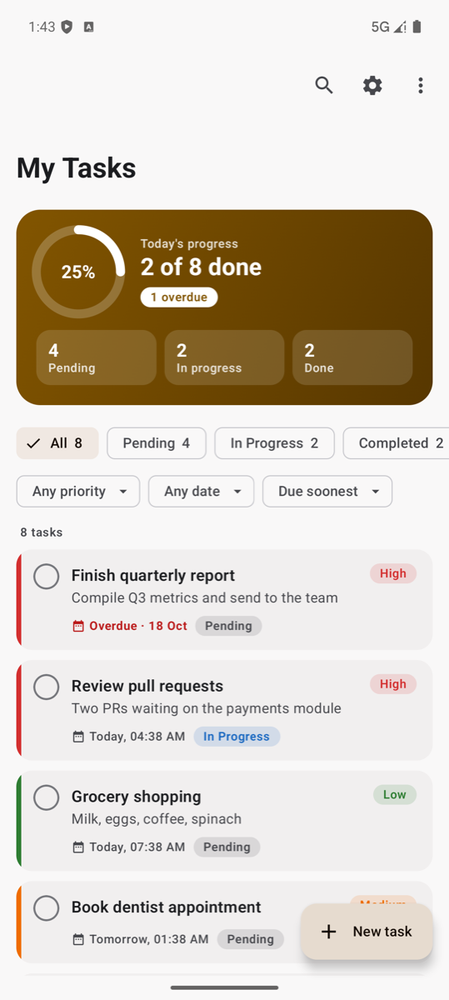
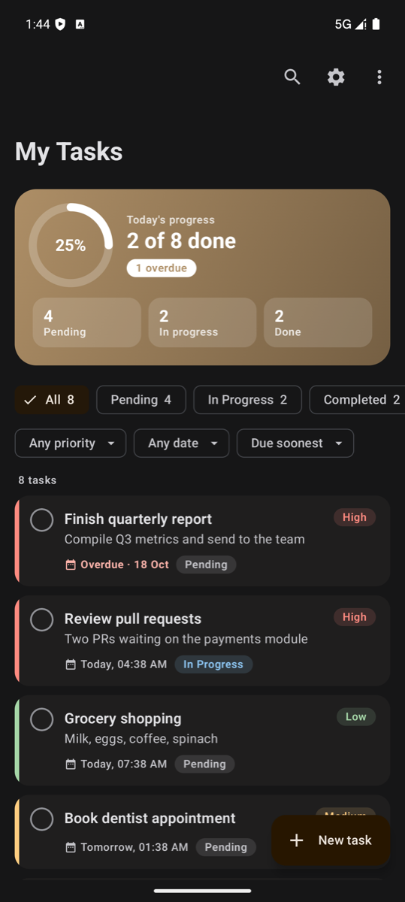
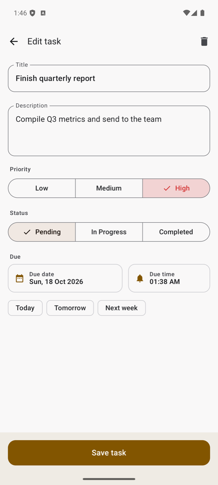

# 📌 Task Manager

A clean, offline-first task manager for Android, built entirely with **Jetpack Compose** and **Material 3**.
Plan your day, track progress at a glance, and keep work organised with filters, search, and swipe gestures.

<p align="center">
  
  
  
</p>

---

## 📥 Download

Grab the latest signed APK from [**GitHub Releases**](https://github.com/Umar888/TaskManager/releases/latest) and open it on your phone (you may need to allow installs from your browser or file manager). Requires Android 8.0 (API 26) or newer.

---

## ✨ Features

### Tasks
- **Create, edit and delete** tasks with a title, description, priority, status and due date + time
- **Quick dates**: one tap for *Today*, *Tomorrow* or *Next week*
- **Inline completion**: tap the round checkbox on any card to finish a task
- **Swipe gestures**: swipe right to complete/reopen, swipe left to delete
- **Undo everywhere**: deletes, completions and "Clear completed" can all be undone from the snackbar
- **Overdue highlighting**: late tasks are flagged in red and counted in the header
- **Unsaved-changes guard**: leaving the editor with edits asks before discarding them

### Organise
- **Progress dashboard**: completion ring plus Pending / In progress / Done counts
- **Status chips** with live counts: *All · Pending · In Progress · Completed*
- **Priority and date filters**: *Overdue, Today, Tomorrow, This week, This month*
- **Sorting**: *Due soonest, Due latest, Priority, Recently added* (completed tasks always sink to the bottom)
- **Search** across titles *and* descriptions
- Filters live in the ViewModel, so they survive opening a task and coming back

### Personalise
- **Theme mode**: System, Light or Dark
- **Accent colour**: 13 curated colours, each checked for contrast in both themes
- **Wallpaper colours** (Material You) on Android 12+
- **Themed app icon** support on Android 13+
- Edge-to-edge layout with smooth, shared slide/fade navigation transitions

---

## 🧱 Tech stack

| Area | Library |
| --- | --- |
| Language | Kotlin 2.4 |
| UI | Jetpack Compose (BOM 2026.09), Material 3 |
| Navigation | Navigation Compose 2.10 |
| Persistence | Room 2.8 (KSP), DataStore Preferences 1.2 |
| Async | Kotlin Coroutines 1.11 + Flow |
| Architecture | MVVM, unidirectional data flow, repository pattern |
| Gestures | [saket/swipe](https://github.com/saket/swipe) 1.3 |
| Testing | JUnit 4, Truth, kotlinx-coroutines-test, Compose UI Test |
| Build | Gradle 9.8, Android Gradle Plugin 9.4, version catalog |

**SDK levels:** `minSdk 26` · `targetSdk 37` · `compileSdk 37.2`

---

## 🗂️ Project structure

```
app/src/main/java/com/example/taskmanager
├── MainActivity.kt              # Entry point: edge-to-edge, theme, nav host
├── data
│   ├── local                    # Room database + DAO
│   ├── model                    # Task entity, TaskStatus, TaskPriority
│   └── repository               # TaskRepository (interface + Room impl), SettingsRepository
├── ui
│   ├── navigation               # Routes + AppNavHost with transitions
│   ├── theme                    # Colours, typography, dynamic colour-scheme generator
│   ├── tasks                    # Task list screen, TaskViewModel, filters/sort/stats
│   │   └── components           # Task card, progress card, filter bar, app bar, FAB, empty state
│   ├── editor                   # Add / edit task screen (one screen for both)
│   └── settings                 # Settings screen + SettingsViewModel
└── util                         # Date helpers
```

**How data flows:** Room emits a `Flow<List<Task>>` → `TaskViewModel` combines it with the current
`TaskFilters` into a single `TaskListUiState` → Compose collects it with `collectAsStateWithLifecycle`.
One-off actions (delete, complete, clear) are sent back as `TaskEvent`s, which the list screen turns into
snackbars with **Undo**.

`TaskRepository` is an interface, so UI tests run against an in-memory fake instead of a real database.

---

## 🚀 Getting started

### Requirements
- Android Studio (latest stable)
- JDK 17+
- Android SDK Platform **37.2** and Build-Tools **37**

### Build and run
```bash
git clone https://github.com/Umar888/TaskManager.git
cd TaskManager
./gradlew installDebug        # or press ▶ Run in Android Studio
```

### Tests
```bash
./gradlew testDebugUnitTest          # JVM unit tests: filters, sorting, stats, dates, ViewModel undo
./gradlew connectedDebugAndroidTest  # Compose UI tests (needs a device or emulator)
```

---

## 📝 What's new in 2.0

**Fixes**
- Back button did nothing on the task detail screen (a second, empty `BackHandler` swallowed it)
- Dark-mode toggle couldn't switch to light while the phone was in dark mode, and the accent colour didn't react to theme changes
- "This week / month / year" filters skipped tasks due earlier on the first day
- Due dates could shift by a day in timezones west of UTC
- Overdue tasks couldn't be edited because the date picker blocked past dates
- Drag-to-reorder looked like it worked but never actually changed anything (removed)
- Snackbars waited a full second before appearing

**Improvements**
- Redesigned list, editor and settings screens; new adaptive app icon
- Add and edit merged into a single editor; delete now asks for confirmation
- Due time picker, quick-date chips, title validation, discard-changes prompt
- Overdue filter, priority sort, description search, clear completed, undo for every action
- Upgraded to the latest Gradle, AGP, Kotlin, Compose and AndroidX libraries
- Reorganised packages by layer/feature and removed unused code and resources
- Added unit tests and rewrote the UI tests for the new screens
